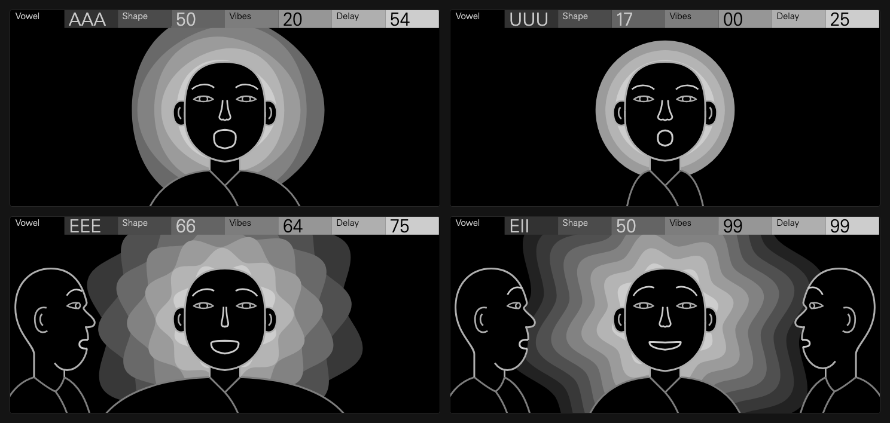

# Ohmonk

A polyphonic chanting monk choir synthesizer for the Teenage Engineering OP-XY, built with the [Open-XY SDK](https://github.com/etcetc000/open-xy).

Each note excites a three-formant vocal tract with glottal pulses and breath (FOF synthesis), passing through a resonant three-wall temple delay. The OP-XY's own filter, envelopes, LFO, and send effects follow the engine, so it plays and sequences like any stock instrument.



## Controls

| Encoder | Control | Readout | What it does |
| :---: | :--- | :---: | :--- |
| **1** | **Vowel** | `OOO` .. `III` | Sweeps smoothly through five vowel formants (`OOO` → `UUU` → `AAA` → `EEE` → `III`) and their intermediate blends. Closed throat drones sit on the left, open chest vowels in the middle, and bright forward vowels on the right. |
| **2** | **Shape** | `00` .. `99` | Reshapes the vocal tract and nasal cavity around a neutral center (`50`). Turning left narrows the throat toward a smaller, brighter head voice; turning right expands the chest into a deep baritone chant. |
| **3** | **Vibes** | `00` .. `99` | Vocal movement and expression. Brings in a natural delayed vibrato that blooms after note attack, subtle pitch drift across voices, and added midrange warmth. |
| **4** | **Delay** | `00` .. `99` | A warm, filtered three-wall echo voiced like a stone hall (`50 ms`, `100 ms`, and `148 ms` reflections), from early room body up to a long cathedral tail. |

On screen, the monk's mouth, nose, shoulders, brow, and mandala rings follow the four controls, with companion monks joining the choir on chords.

## Presets

| Preset | Vowel | Shape | Vibes | Delay | Character |
| :--- | :---: | :---: | :---: | :---: | :--- |
| **Monotone Mantra** | `OOO` (`04`) | `50` | `00` | `00` | Dry, steady `OOO` throat drone with a neutral vocal tract and no vibrato. |
| **Tibetan Chant** | `UAA` (`46`) | `58` | `38` | `65` | Warm monastery choir with natural vibrato bloom and stone room echo. |
| **Dorje Giant** | `OOU` (`12`) | `92` | `00` | `85` | Deep, wide-chested low formant voice in a long reverberant hall. |
| **Little Lama** | `EEE` (`78`) | `08` | `72` | `00` | Small, focused vocal tract with bright `EEE` articulation and lively vibrato. |
| **Nasal Overtone** | `AEE` (`68`) | `25` | `00` | `48` | Forward nasal resonance tuned for clear melodic leads and overtone lines. |
| **Wandering Monk** | `UAA` (`50`) | `75` | `88` | `90` | Full baritone choir with wide vibrato, random LFO vowel movement, and a deep temple tail. |

## Files & Technical Notes

| File | Purpose |
| :--- | :--- |
| [`definition.json`](definition.json), [`machine.json`](machine.json) | Controls, preset definitions, resource bounds, and machine identity |
| [`core.h`](core.h), [`engine.cpp`](engine.cpp), [`tables.h`](tables.h) | 32-bit fixed-point FOF voice engine, 3-wall delay, and lookup tables |
| [`display.h`](display.h), [`display.cpp`](display.cpp), [`panel.svg.fragment`](panel.svg.fragment) | 256-node choir and mandala animation in the stock 8-shade greyscale palette |
| [`presets/`](presets/) | Six device presets installed to `content/presets/ohmonk/` |
| [`tests/sound.cpp`](tests/sound.cpp) | Host audio, control sweep, polyphony, and lifecycle verification |

- **DSP:** Pure 32-bit `Q31` / `Q15` fixed-point synthesis (no float, division, or 64-bit math in the render path). Shared `10 ms` 3-formant FOF grain overlap-add with per-voice `11.025 kHz` 3-wall temple delay and anti-imaging reconstruction.
- **Footprint:** 12-voice polyphony (`56 B` voice / `67,888 B` shared, `107.8 KiB` module size).
- **Hardware CPU (`opxy-synth-c8-v1`):** **`2.644%`** median of the stock `580,352`-cycle block budget across 3 runs (`2.649%`, `2.644%`, `2.643%`); `~2,300` host-estimated Blackfin instructions per voice block.

## Develop & Test

Keep the [Open-XY SDK](https://github.com/etcetc000/open-xy) beside this repository as `../open-xy` (on branch `staging`).

```sh
python3 ../open-xy/sdk.py preview --machine . --out ../previews/ohmonk-001
python3 ../open-xy/tools/serve_harness.py --preview ../previews/ohmonk-001
python3 ../open-xy/sdk.py test --machine . --cxx clang++ --host-cxx g++
python3 ../open-xy/sdk.py test --firmware --machine .
```

## Credits & License

- **Author:** **Alex Hatch (Hatch)** (`@hatchman`)
- **Upstream Open-Source Reference:** Fixed-point `Q31` adaptation of **[MonkSynth](https://github.com/JonET/monksynth)** by **Jonathan Taylor (`JonET`)** (MIT License, Copyright (c) 2026 Jonathan Taylor).
- **FOF (Formant-Wave-Function) Synthesis:** Mathematical synthesis technique published by **Xavier Rodet** (*Computer Music Journal*, 1984).
- **Original Inspiration:** Inspired by the classic [**Delay Lama**](http://www.audionerdz.nl/) VST instrument by **AudioNerdz** (2002).

MIT License — see [LICENSE](LICENSE).
